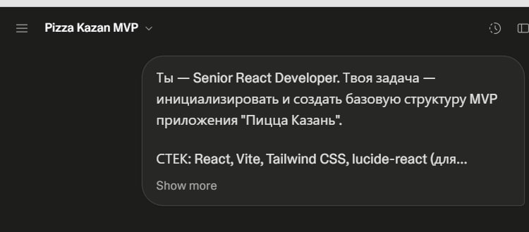
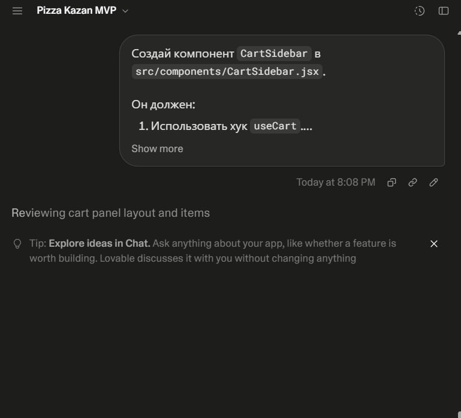
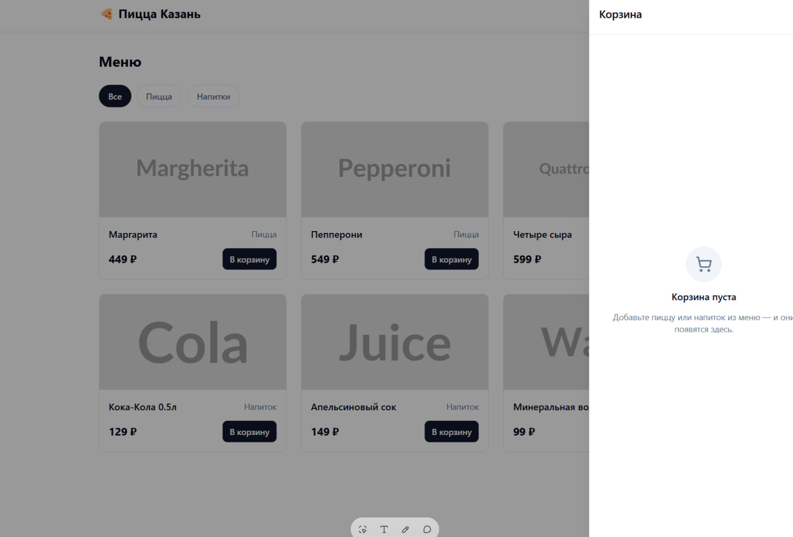
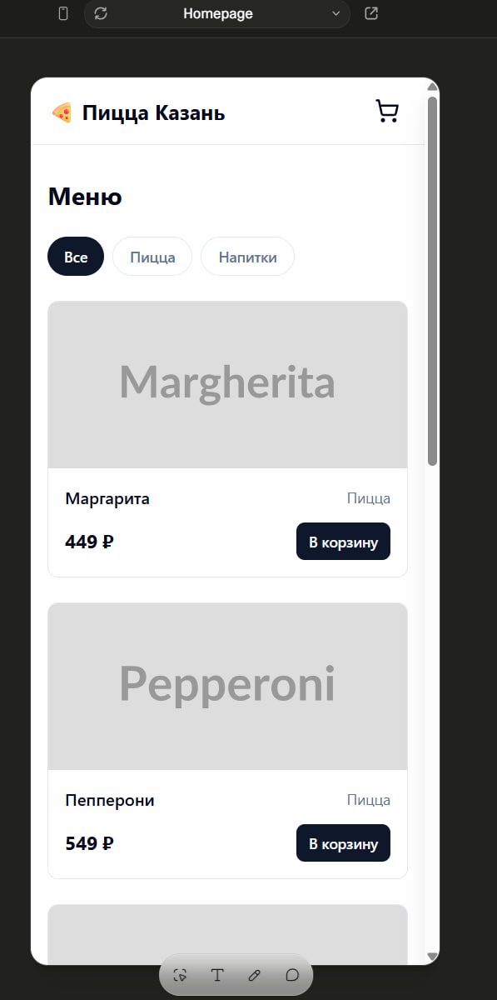

# Отчет о разработке Frontend-приложения (ДЗ4)

**Проект:** MVP "Пицца Казань"  
**Инструмент:** Lovable.dev (Cloud AI Agent)  
**Стек:** React, Vite, Tailwind CSS  

## 1. Описание процесса разработки
Разработка велась итеративно с использованием Cloud AI-агента (Lovable.dev). Процесс был разделен на логические этапы: инициализация проекта, создание хука управления состоянием (`useCart`), реализация компонентов каталога и корзины, а также финальная адаптивная верстка.

## 2. Примененные техники работы с AI
- **Chain-of-Thought (CoT):** Сложная задача "Реализация корзины" была разбита на шаги: 1) проектирование хука состояния, 2) создание UI-компонента, 3) написание тестов.
- **Использование системных правил:** Перед генерацией кода агенту передавались строгие инструкции (из ДЗ2): использовать только функциональные компоненты, Tailwind CSS без инлайн-стилей, выдавать полный код файла.
- **Итеративный рефакторинг:** После первоначальной генерации компоненту `CartItem` был отправлен запрос на добавление `aria-label` для доступности и улучшение адаптивности.

## 3. Примеры промптов и результатов
**Промпт для генерации хука корзины:**
> "Создай кастомный React-хук `useCart`. Он должен управлять массивом объектов. Реализуй функции: addItem, removeItem, updateQuantity. Добавь useMemo для totalPrice. Выдай только код на JS с JSDoc."

**Результат:** Агент сгенерировал чистый, типизированный (через JSDoc) хук без избыточных зависимостей, который был успешно интегрирован в компоненты.

## 4. Описание проблем и их решений
| Проблема | Решение с помощью AI |
| :--- | :--- |
| **Дублирование кода** в обработчиках кнопок "+" и "-" | Отправлен промпт на рефакторинг: агент объединил логику в одну функцию `handleQuantityChange(id, delta)`, проверив граничное условие `quantity > 0`. |
| **Проблемы адаптивности** на мобильных устройствах (карточки сжимались) | Отправлен скриншот бага с промптом: "Исправь верстку карточки товара. Используй `grid-cols-1` для мобильных и `md:grid-cols-3` для десктопа. Добавь `min-w-0` для предотвращения переполнения flex-контейнера". |

## 5. Выводы и рекомендации
1. Cloud-агенты (Lovable.dev) идеально подходят для быстрого прототипирования MVP и генерации boilerplate-кода.
2. Наличие заранее подготовленного `rules.md` (из ДЗ2) критически снижает количество итераций "исправь стиль кода".
3. Для production-готовности рекомендуется перенести сгенерированный код в локальную IDE (например, Cursor) для более глубокого ревью и настройки CI/CD.

## 6. Демонстрация работы

**Рисунок 1:** Инициализация проекта и базовая структура

**Рисунок 2:** Работающий каталог с фильтрацией по категориям

**Рисунок 3:** Функциональность корзины (добавление, изменение количества)

**Рисунок 4:** Адаптивная верстка (мобильная версия)

---
**Ссылка на репозиторий:** https://github.com/JohnyWinchester/cheesy-cart-quest
